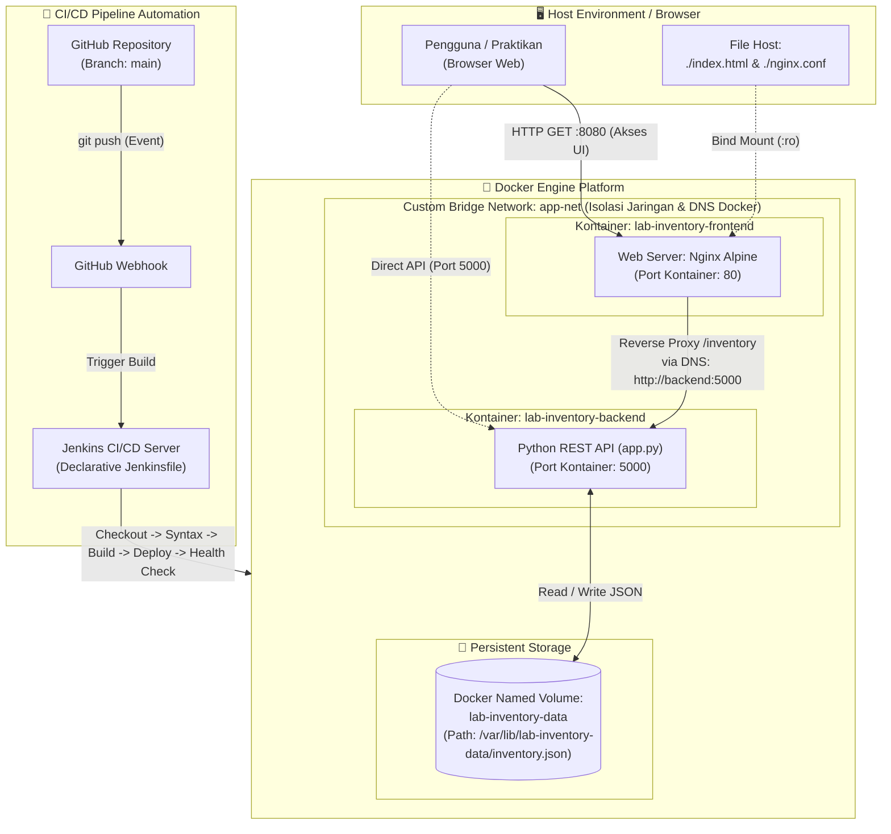

# 📦 Inventaris Barang Laboratorium (Lab Inventory Catalog)

> **Ujian Chunin Cloud Computing — Proyek Kelompok UTS**  
> **Program Studi S1 Informatika / Teknik Komputer — Telkom University**  
> **Dosen Pengampu:** CSO

---

## 👥 Identitas Anggota Kelompok

| No | Nama Lengkap | NIM |
| 1 | [Muhamad Ridho Aulia Algifari] | [101012300085] 
| 2 | [Muhammad Fizhuka Ihza] | [101012330399] 
| 3 | [Muhammad Nabil Nafis Savero] | [101012300147] 

---

## 📋 1. Deskripsi Studi Kasus

Proyek ini mengimplementasikan **Studi Kasus 4: Inventaris Barang Laboratorium (Lab Inventory Catalog)**. Aplikasi ini dirancang sebagai sistem pencatatan ketersediaan dan peminjaman alat-alat laboratorium (seperti Mikrotik Router, Modem Orbit, Switch Cisco, Kabel UTP Cat6, Crimping Tool, dll.) berbasis *cloud-native fullstack* dengan isolasi kontainer dan otomatisasi CI/CD.

### Fitur Utama:
- **Katalog Alat Laboratorium**: Menampilkan seluruh data alat secara real-time (Nama alat, Kategori, Jumlah unit/stok, Status/Kondisi, Peminjam, Lokasi rak).
- **Penambahan Alat Baru**: Form interaktif dengan validasi input untuk mendaftarkan alat lab baru melalui HTTP POST.
- **Penghapusan Alat**: Tombol hapus real-time dengan konfirmasi interaktif melalui HTTP DELETE berbasis indeks.
- **Pencarian & Pemfilteran**: Pencarian langsung (*real-time filter*) berdasarkan nama alat, kategori, dan status ketersediaan.
- **Kekebalan Data (*Data Immunity*)**: Seluruh data tersimpan secara persisten pada file `inventory.json` di dalam **Docker Named Volume** (`lab-inventory-data`), menjamin data tidak hilang meskipun kontainer dihancurkan (*dismantled*).
- **Pengembangan Cepat (*Hot Reloading*)**: Menggunakan **Docker Bind Mount** pada file frontend (`index.html`) ke direktori web server Nginx, sehingga modifikasi UI dapat langsung dilihat tanpa perlu *rebuild image*.

---

## 🏛️ 2. Arsitektur Sistem & Diagram Docker

Sistem terdiri atas dua *service* utama yang terisolasi dalam satu **Custom Bridge Network** (`app-net`):



### Penjelasan Komponen Arsitektur:
1. **Frontend Service (`lab-inventory-frontend`)**:
   - Menjalankan image `nginx:alpine`.
   - Menggunakan **Bind Mount** dari host (`./index.html` dan `./nginx.conf`) ke `/usr/share/nginx/html/index.html` dan `/etc/nginx/conf.d/default.conf`.
   - Berfungsi ganda: melayani aset statis web dan bertindak sebagai *reverse proxy* yang meneruskan permintaan API (`/inventory`, `/messages`, `/health`) ke backend melalui DNS internal Docker `http://backend:5000`.
   - Dipublikasikan ke port host `8080`.
2. **Backend Service (`lab-inventory-backend`)**:
   - Dibangun dari `Dockerfile` menggunakan Python 3.11 tanpa framework berat (menggunakan `http.server.ThreadingHTTPServer` standar bawaan Python).
   - Menyediakan REST API JSON lengkap dengan penanganan error presisi (HTTP 200, 201, 400, 404).
   - Dipublikasikan ke port host `5000`.
3. **Penyimpanan Terisolasi (Docker Named Volume `lab-inventory-data`)**:
   - Volume independen yang dimount ke `/var/lib/lab-inventory-data`.
   - Menyimpan berkas `inventory.json`.
   - Data tetap aman sekalipun kontainer dihentikan atau dihapus paksa (`docker rm -f`).
4. **Isolasi Jaringan (Custom Bridge Network `app-net`)**:
   - Memastikan komunikasi antar-kontainer terjadi secara privat dengan *Docker internal DNS resolution* tanpa mengekspos port privat ke jaringan luar.

---

## 📁 3. Struktur Berkas Proyek

```text
INVENTARIS LAB PROJECT/
├── .dockerignore                 # Berkas pengecualian build Docker
├── .gitignore                    # Berkas pengecualian pelacakan Git
├── Dockerfile                    # Spesifikasi build kontainer Python Backend
├── docker-compose.yml            # Definisi orkestrasi multi-kontainer, volume, & network
├── index.html                    # Frontend UI (HTML5, Vanilla JS, Tailwind CSS via CDN)
├── Jenkinsfile                   # Skrip 5-Stage Declarative CI/CD Pipeline
├── nginx.conf                    # Konfigurasi Nginx Web Server & Reverse Proxy
├── app.py                        # Kode sumber REST API Python Backend
├── test_unit.py                  # Unit test internal REST API
└── README.md                     # Dokumentasi komprehensif proyek
```

---

## 📡 4. Dokumentasi Spesifikasi REST API

Backend menyediakan endpoint RESTful berbasis format JSON murni:

### 1. Ambil Katalog Alat (`GET /inventory` atau `GET /messages`)
- **Method**: `GET`
- **URL**: `http://localhost:8080/inventory` (atau `http://localhost:5000/inventory`)
- **Status Respons**: `200 OK`
- **Contoh Respons JSON**:
  ```json
  {
    "success": true,
    "total": 5,
    "data": [
      {
        "id": 1,
        "nama_alat": "Mikrotik RouterBoard RB750Gr3",
        "kategori": "Jaringan & Routing",
        "jumlah": 8,
        "kondisi": "Tersedia",
        "peminjam": "-",
        "lokasi_rak": "Rak Jaringan A1",
        "tanggal_update": "2026-11-11 21:00:00"
      }
    ]
  }
  ```

### 2. Tambah Alat Baru (`POST /inventory` atau `POST /messages`)
- **Method**: `POST`
- **URL**: `http://localhost:8080/inventory`
- **Headers**: `Content-Type: application/json`
- **Contoh Request Body**:
  ```json
  {
    "nama_alat": "Modem Telkomsel Orbit Pro",
    "kategori": "Modem & Wireless",
    "jumlah": 3,
    "kondisi": "Tersedia",
    "peminjam": "-",
    "lokasi_rak": "Rak Wireless B1"
  }
  ```
- **Status Respons**: `201 Created`
- **Error Handling (400 Bad Request)**:
  - Jika `nama_alat` kosong:
    ```json
    { "success": false, "error": "Field 'nama_alat' (atau 'item_name') wajib diisi dan tidak boleh kosong." }
    ```
  - Jika format body bukan JSON valid:
    ```json
    { "success": false, "error": "Format JSON tidak valid..." }
    ```

### 3. Hapus Alat Berdasarkan Indeks (`DELETE /inventory?index=X`)
- **Method**: `DELETE`
- **URL**: `http://localhost:8080/inventory?index=0`
- **Status Respons**: `200 OK`
- **Contoh Respons JSON**:
  ```json
  {
    "success": true,
    "message": "Item 'Mikrotik RouterBoard RB750Gr3' pada index 0 berhasil dihapus.",
    "deleted_index": 0,
    "deleted_item": { ... },
    "remaining_items": 4
  }
  ```
- **Error Handling**:
  - `400 Bad Request`: Jika parameter `?index=` tidak disertakan atau bukan angka bulat.
  - `404 Not Found`: Jika indeks berada di luar rentang daftar alat yang tersedia.

### 4. Health Check Service (`GET /health`)
- **Method**: `GET`
- **URL**: `http://localhost:8080/health`
- **Status Respons**: `200 OK`
- **Fungsi**: Digunakan pada Stage 5 Jenkins CI/CD untuk verifikasi ketersediaan layanan pasca-deployment.

---

## 🛠️ 5. Panduan Instalasi & Menjalankan di Komputer Lokal

### Prasyarat:
- [Docker Desktop](https://www.docker.com/products/docker-desktop/) telah terpasang dan berstatus aktif (*running*).
- [Git](https://git-scm.com/) untuk manajemen versi.

### Langkah-langkah:
1. **Clone Repositori:**
   ```bash
   git clone <URL_REPOSITORI_GITHUB_KELOMPOK>
   cd "INVENTARIS LAB PROJECT"
   ```

2. **Jalankan Aplikasi dengan Docker Compose:**
   ```bash
   docker-compose up -d --build
   ```
   *(Atau `docker compose up -d --build` jika menggunakan Docker Compose V2).*

3. **Periksa Status Kontainer:**
   ```bash
   docker-compose ps
   ```
   Pastikan kontainer `lab-inventory-backend` dan `lab-inventory-frontend` berada pada status `Up`.

4. **Akses Antarmuka Web (UI):**
   - Buka browser web favorit Anda: [http://localhost:8080](http://localhost:8080)
   - Anda akan melihat status indikator hijau **"Backend Terhubung"**, data statistik alat lab, formulir tambah alat, dan tabel katalog.

---

## 🧪 6. Prosedur Pengujian (*Verification & Rubric Compliance*)

### A. Pengujian Data Immunity (Kekebalan Data Named Volume)
Pengujian ini membuktikan bahwa penghancuran kontainer backend **tidak akan menghilangkan data**:
1. Buka web UI pada browser ([http://localhost:8080](http://localhost:8080)), lalu tambahkan 1 alat baru (misal: `"Alat Uji Ketahanan Data"`).
2. Hapus paksa kontainer backend melalui terminal host:
   ```bash
   docker rm -f lab-inventory-backend
   ```
3. Refresh browser web; UI akan menampilkan status terputus karena kontainer telah dihapus.
4. Jalankan kembali kontainer backend menggunakan volume yang sama:
   ```bash
   docker-compose up -d backend
   ```
5. Refresh browser web Anda. **Hasil**: Data `"Alat Uji Ketahanan Data"` tetap ada secara utuh karena tersimpan di Named Volume `lab-inventory-data`!

### B. Pengujian Bind Mount (Pengembangan UI Tanpa Rebuild)
1. Buka file `index.html` pada teks editor di komputer host Anda.
2. Ubah judul atau warna tema (misal ubah teks `Lab Inventory Catalog` menjadi `Lab Inventory Catalog - Uji Bind Mount`).
3. Simpan berkas (`Ctrl + S`).
4. Segera *refresh* halaman browser [http://localhost:8080](http://localhost:8080).
5. **Hasil**: Perubahan langsung tampil seketika **tanpa perlu menjalankan `docker build`**.

---

## 🚀 7. Panduan Konfigurasi Jenkins CI/CD & GitHub Webhook

Skrip `Jenkinsfile` mengimplementasikan **5 Stage Declarative Pipeline**:
1. **Stage 1 (Checkout)**: Mengambil source code terbaru dari GitHub.
2. **Stage 2 (Syntax Check)**: Validasi integritas kode Python dengan modul `py_compile`.
3. **Stage 3 (Build Image)**: Membangun image Docker `lab-inventory-backend` secara otomatis.
4. **Stage 4 (Automated Deployment)**: Merestart stack dengan `docker-compose down` dan `docker-compose up -d`.
5. **Stage 5 (Health Check)**: Menguji kesiapan HTTP endpoint `/health` via `curl`.

### Langkah Konfigurasi:

#### 1. Buat GitHub Personal Access Token (PAT)
1. Masuk ke GitHub ➔ Klik foto profil di kanan atas ➔ **Settings**.
2. Pilih menu **Developer settings** di bilah kiri bawah.
3. Pilih **Personal access tokens** ➔ **Tokens (classic)** ➔ **Generate new token (classic)**.
4. Isi **Note**: `Jenkins CI/CD UTS Token`, Expiration: `90 days`.
5. Beri centang pada izin wajib:
   - `[x] repo` (Akses repositori penuh)
   - `[x] admin:repo_hook` (Manajemen Webhook)
6. Klik **Generate token**, lalu salin string token (`ghp_xxxxxxxxxxxx`).

#### 2. Tambahkan Kredensial di Jenkins
1. Buka Jenkins dashboard ➔ **Manage Jenkins** ➔ **Credentials** ➔ **System** ➔ **Global credentials (unrestricted)**.
2. Klik **Add Credentials**:
   - **Kind**: `Username with password`
   - **Username**: Isi dengan *username* akun GitHub Anda.
   - **Password**: Tempelkan *Personal Access Token (PAT)* yang telah dibuat.
   - **ID**: `github-uts-credentials` (atau biarkan default).
3. Klik **Create**.

#### 3. Buat Pipeline Job di Jenkins
1. Di Dashboard Jenkins, klik **New Item**.
2. Masukkan nama: `lab-inventory-pipeline`, pilih **Pipeline**, klik **OK**.
3. Pada tab **Build Triggers**, centang:
   - `[x] GitHub hook trigger for GITScm polling`.
4. Pada tab **Pipeline**:
   - **Definition**: Pilih `Pipeline script from SCM`.
   - **SCM**: Pilih `Git`.
   - **Repository URL**: Masukkan tautan repo Anda (contoh: `https://github.com/username/inventaris-lab-project.git`).
   - **Credentials**: Pilih kredensial GitHub yang telah disimpan.
   - **Branch Specifier**: `*/main`.
   - **Script Path**: `Jenkinsfile`.
5. Klik **Save**.

#### 4. Hubungkan GitHub Webhook
1. Buka repositori proyek Anda di situs GitHub.
2. Klik **Settings** ➔ **Webhooks** ➔ **Add webhook**.
3. **Payload URL**: Masukkan URL Jenkins Anda diikuti endpoint webhook:
   ```text
   http://<IP_PUBLIC_ATAU_NGROK_JENKINS>:8080/github-webhook/
   ```
   *(Jika Jenkins berjalan di localhost, gunakan tunnel seperti [ngrok](https://ngrok.com/) dengan perintah `ngrok http 8080` untuk memperoleh public URL).*
4. **Content type**: Pilih `application/json`.
5. **Which events would you like to trigger this webhook?**: Pilih `Just the push event`.
6. Klik **Add webhook**. Simbol centang hijau menandakan webhook berhasil terhubung.

---

## 📹 8. Panduan & Skenario Video Demo UTS (Durasi 5–8 Menit)

Gunakan susunan skenario berikut saat merekam video demonstrasi kelompok untuk meraih **nilai maksimal (85–100)**:

| Menit | Segmen Demonstrasi | Hal yang Ditampilkan di Layar |
|---|---|---|
| **00:00 - 01:00** | **Pembukaan & Pengenalan Arsitektur** | - Salam pembuka, perkenalan nama & NIM semua anggota kelompok.<br>- Menjelaskan pemilihan **Studi Kasus 4: Inventaris Barang Laboratorium**.<br>- Menampilkan diagram arsitektur Docker Compose & alur CI/CD. |
| **01:00 - 02:30** | **Demonstrasi Web UI & REST API** | - Menampilkan halaman web [http://localhost:8080](http://localhost:8080).<br>- Menunjukkan indikator koneksi backend aktif.<br>- Menambahkan alat baru via form UI (POST) dan melihat tabel ter-update tanpa reload halaman.<br>- Menghapus alat via tombol merah (DELETE) dan verifikasi respon JSON di Inspect Element / Network Tab. |
| **02:30 - 04:00** | **Simulasi Data Immunity (Named Volume)** | - Buka terminal, jalankan `docker rm -f lab-inventory-backend` di depan kamera.<br>- Tunjukkan bahwa kontainer backend benar-benar mati.<br>- Jalankan kembali dengan `docker-compose up -d backend`.<br>- Refresh browser, buktikan bahwa seluruh data inventaris yang baru ditambahkan **tetap utuh dan tidak hilang** berkat Named Volume `lab-inventory-data`. |
| **04:00 - 05:00** | **Simulasi Bind Mount Frontend** | - Ubah sedikit teks di `index.html` pada VS Code / editor.<br>- Refresh browser di [http://localhost:8080](http://localhost:8080).<br>- Tunjukkan perubahan muncul seketika tanpa `docker build`. |
| **05:00 - 07:00** | **Simulasi CI/CD Otomatis (Git Push ➔ Auto Deploy)** | - Ubah komentar atau versi di `app.py` atau `index.html`.<br>- Lakukan `git add .`, `git commit -m "feat: update katalog"`, dan `git push origin main`.<br>- Tampilkan layar Jenkins: perlihatkan build otomatis terpicu oleh GitHub Webhook.<br>- Buka **Console Output** Jenkins dan jelaskan keberhasilan setiap 5 stage (*Checkout, Syntax Check, Build Image, Automated Deployment, Health Check*). |
| **07:00 - 08:00** | **Penutup & Kesimpulan** | - Ringkasan pencapaian rubrik 100%.<br>- Ucapan terima kasih dan penutupan. |

---

## ⚖️ 9. Lisensi & Hak Cipta
Dibuat untuk keperluan akademik Mata Kuliah Cloud Computing — Telkom University. Bebas digunakan dan dikembangkan untuk keperluan edukasi.
